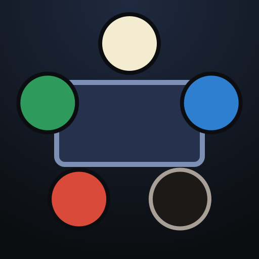

# Podside



A life tracker for in-person Commander (EDH) games of Magic: The Gathering, built for pods of three or more. A shared **table display** (TV, monitor or tablet in a browser) shows every player's totals, and each player updates totals from **their phone**, the way Jackbox works.

It runs as one small Python process with no accounts and no database, so it's easy to host on a home server and use over the local network.

## Features

- **TV display:** large tiles with life, poison and commander damage, deck color pips, a QR code to join, and a settings panel for starting life, table edits, seat order and removing players. It keeps the screen awake.
- **Phone controls:** big +/- buttons with hold to repeat, a commander damage picker, undo, and tabs for editing other players when table edits are on. There's a fullscreen button where the browser supports it, and the screen stays awake during a game.
- **Undo** reverses any change exactly, and rapid taps are grouped so one undo takes back a burst.
- **Reconnecting:** a phone that drops gets its seat back automatically.
- **Save and resume:** download a game as a JSON file from the TV or any phone, and resume it later from the landing page. Players tap their name to take their seat back.

## Quick start

```bash
python -m venv .venv && source .venv/bin/activate
pip install -r requirements.txt
uvicorn main:app --host 0.0.0.0 --port 8000 --reload
```

Open `http://<host>:8000/` on the TV and click **Start a game**; that screen becomes the scoreboard. Players scan its QR code, or open the same address on their phone and type the 4-letter room code.

## Deploying

The app runs as one Docker container (see `Dockerfile` and `docker-compose.yml`), behind a reverse proxy for HTTPS.

1. Copy `deploy.sh.example` to `deploy.sh`, set `HOST` and `REMOTE_DIR`, and run `sh deploy.sh`. It rsyncs the source to the server and runs `docker compose up -d --build` there. A redeploy ends any games in progress, because rooms live in memory.
2. In Nginx Proxy Manager, add a proxy host for the subdomain: scheme `http`, forward to the Docker host's IP on port `8086` (the host port in `docker-compose.yml`), and turn on **Websockets Support**. On the SSL tab, request a Let's Encrypt certificate and turn on **Force SSL**.

Keep it to one worker (`--workers 1`, already set in the Dockerfile). One process hosts any number of rooms at once, but they live in its memory, so a second worker would have its own separate set of rooms.

HTTPS matters for more than security: browsers only let the display and the phones keep their screens awake on HTTPS pages (or on `localhost`).

## Architecture

```
 Table display (TV)        Player phones
   view + admin          own totals (or anyone's
                         with table edits on)
        \                      /
         \     WebSocket      /
          +---- Room server -+      FastAPI, single process
                   |
              Room state            in memory
```

- **The server is the only source of truth.** Clients never set values directly. They send *actions*, and the server validates them, applies them under a per-room `asyncio.Lock`, adds them to the undo log, and sends the full room state to every connection.
- **Actions, not values.** If two people tap at the same moment, both changes count. Each action is saved as a list of reversible `Change` tuples `(player_id, field, key, delta)`, so undo just reverses them in order. Rapid repeats of the same action are grouped into one entry (see *Grouping rapid taps* below).
- **Full state on every update.** State is small (8 players max), so the server sends a complete snapshot after each change and on connect. That keeps reconnects simple. Every snapshot carries a `seq` number.
- **Reconnect by token.** Joining gives the player a token, which the client keeps in `localStorage`. Connecting with `?token=` gives the player their seat back.

### Rules built in

| Rule | Value |
|---|---|
| Default starting life | 40 |
| Max players | 8 |
| Poison lethal | 10 |
| Commander damage lethal | 21 from a single source |
| Commander damage | also lowers life, and undo reverses both |
| Permissions | `table_edits` is on by default, so anyone can change anyone's totals. Turn it off to limit players to their own; the display can always change anything |

## HTTP endpoints

| Method | Path | Purpose |
|---|---|---|
| `POST` | `/api/rooms?starting_life=40` | Create a room. Returns `code`, `display_url`, `play_url` |
| `GET` | `/api/rooms/{code}` | Current room snapshot |
| `GET` | `/api/rooms/{code}/save` | The game as a save file (JSON, downloaded as an attachment). See *Saving and resuming* |
| `POST` | `/api/rooms/resume` | Body: a save file. Starts a new room from it and returns `code`, `display_url`, `play_url`, or 400 with a readable `detail` |
| `GET` | `/api/rooms/{code}/qr.svg?base=https://host` | QR code (SVG) for `{base}/play/{code}`. The display passes its own origin, so the code matches the proxy's domain. `base` must be `http(s)://host[:port]` with no path |
| `GET` | `/` | Landing page: start a game (this screen becomes the scoreboard) or join one by room code |
| `GET` | `/display/{code}` | Display view for the TV (404 if the room doesn't exist) |
| `GET` | `/play/{code}` | Player view for phones (404 if the room doesn't exist) |
| `GET` | `/config.js` | Rule numbers and seat colors for the pages, generated from the Python constants |
| `GET` | `/{file}` | Other files in `static/` (CSS and JS), served by `app.frontend()` after every other route |

## WebSocket protocol

Connect to `/ws/{code}?role=display` or `/ws/{code}?role=player[&token=...]`. All messages are JSON.

**Client → server**

```jsonc
{"type": "join", "name": "Kit", "colors": "WU"}                // player connections only; colors optional
{"type": "join", "seat": "p2"}                                 // take an unclaimed seat in a resumed game
{"type": "life", "target": "p1", "delta": -3}
{"type": "poison", "target": "p1", "delta": 1}
{"type": "cmd_damage", "target": "p1", "source": "p2", "delta": 5}  // source may equal target (a stolen commander)
{"type": "counter", "target": "p1", "name": "energy", "delta": 1}
{"type": "rename", "target": "p1", "name": "Kit"}
{"type": "colors", "target": "p1", "colors": "WUG"}           // deck colors; "" clears, not undoable
{"type": "remove", "target": "p3"}                             // take a player out; undoable
{"type": "reorder", "order": ["p3", "p1", "p2"]}               // seat order; every player once, not undoable
{"type": "undo"}
{"type": "reset"}                                              // new game, same players
{"type": "settings", "starting_life": 40, "table_edits": true}
{"type": "ping"}
```

`target` defaults to the sender's own player when left out.

**Deck colors** are letters from `WUBRG` (white, blue, black, red, green), or `C` alone for colorless. The server accepts them in any order and case and stores them in WUBRG order, so `"gw"` becomes `"WG"`. Unknown letters, or `C` mixed with colors, are rejected. Like `rename`, `colors` follows the edit permissions and isn't undoable.

**Server → client**

```jsonc
{"type": "welcome", "player_id": "p1", "token": "..."}
{"type": "state", "state": {
  "code": "WEVK", "seq": 12, "starting_life": 40, "table_edits": true,
  "players": [{"id": "p1", "name": "Kit", "life": 37, "poison": 0,
               "cmd_damage": {"p2": 3}, "counters": {}, "eliminated": false, "colors": "WU",
               "claimed": true}],
  "last_action": {"seq": 12, "actor": "p1", "ts": 1732327748.6,
                  "action": {"type": "life", "target": "p1", "delta": -3}},
  "departed": {"p3": "Sam"}
}}
{"type": "error", "message": "..."}
{"type": "pong"}
```

`last_action` is the newest entry in the undo history, or `null`. Its `action` is the server's normalised copy, not the client's message: it always has the resolved `target`, an integer `delta` (after clamping), and `source` for `cmd_damage` or `name` for `counter`, and nothing else. A `remove` has `target` and the removed player's `name` instead of a `delta`.

**Removing players.** `remove` follows the edit permissions: the display can remove anyone, a player can always remove themselves, and others only with `table_edits` on. The player's seat, totals and token are kept in the undo history, so `undo` restores them in the same seat and their open phone carries on. Undo is refused while the room is full. Commander damage a removed player dealt stays on the others (it still counts toward 21), and `departed` maps their id to their name for as long as any of it remains. A removed phone's next `join` gets a new seat.

**Saving and resuming.** A save file holds `format` (`"podside-save"`), `version` (1), `saved_at`, the old `code` (for reference), `starting_life`, `table_edits`, `departed`, and `players` in seat order with `id`, `name`, `colors`, `life`, `poison`, `cmd_damage` and `counters`. It never holds tokens or the undo history. Resuming checks the file strictly (at most 64 KB and 8 players, whole numbers in range, valid colors, commander damage only from known players) and creates a new room with a new code. Restored players start with `claimed: false`: they have no token, so nobody can reconnect as them until a phone sends `join` with their `seat`, which gives that phone a fresh token. Anyone can claim an unclaimed seat, even with `table_edits` off. Claiming isn't undoable, and the resumed game starts with nothing to undo.

**Seat order.** `reorder` sets the order of `players` (the TV's tile order and the phones' tabs). `order` must list every current player exactly once, so a stale list is rejected rather than half applied. The display can always reorder; players only with `table_edits` on. Like `rename`, it changes no totals and isn't undoable.

**Grouping rapid taps.** When the same actor repeats the same action (same type, target, and source or counter name) within 400 ms of their previous one, the server folds it into that history entry instead of adding a new one. Every tap still applies and broadcasts straight away. The entry's `delta` becomes the running total and `ts` moves to the latest tap, so `seq` stays the same while `delta` changes. One undo reverses the whole group. A group that nets to zero is removed. After an undo, the entry it exposes is closed, so the next tap starts a new group.

## Code layout

| File | What's there |
|---|---|
| `models.py` | Config constants, `ActionError`, and the domain model: `Player`, `Change`, `LogEntry`, `Room` (state, apply/commit/undo/reset) |
| `rooms.py` | `RoomManager` and the shared `manager`: create/get rooms, idle cleanup |
| `actions.py` | `handle_action()`: validates and applies each action type |
| `app.py` | FastAPI routes, the `/ws/{code}` endpoint, `broadcast_state()`, and serving the pages |
| `static/` | The pages as plain files: `index`, `display` and `play` (`.html`, `.css`, `.js` each), plus `pips.css` (deck color pips) and `shared.js` (pips and the save link, used by the display and player pages). The app icon is `icon.svg`; `favicon-32.png`, `icon-192.png` and `apple-touch-icon.png` (180 px, for iPhone home screens) are rendered from it, so re-render them if it changes. The pages read the room code from their URL |
| `saves.py` | Save files: `dump()` a room, `parse()` and check an upload, `restore()` it into a new room |
| `qr.py` | Small QR encoder (byte mode, level M) with no dependencies, used for the join code |
| `main.py` | Entry point that re-exports `app`, so `uvicorn main:app` works |
| `tests/` | pytest suite. `conftest.py` has a `Table` helper that drives a display and several players over real WebSockets |

Run the tests with `pip install pytest && pytest -q`.

## Ideas

Nothing here is promised. These are possibilities, roughly in order of interest.

- [x] Pages as plain files in `static/` instead of inline HTML
- [ ] Event history for the current game: each change with its time and "time ago" (e.g. "Sam −5 life · 9:42 PM · 3 min ago")
- [ ] Partner commanders (two damage sources per player)
- [ ] Monarch, initiative, day/night, and other table-wide markers
- [ ] Turn tracking and an optional turn timer
- [ ] Commander art behind each tile (would need an outside card API such as Scryfall)
- [ ] Keeping games across restarts automatically (save files cover this by hand), and game history or stats built on that

## Constraints and conventions

- Python 3.11+, FastAPI, with no build step for the front end (vanilla JS)
- One server process holds every room in memory; any number of games can run at once. Shared storage such as Redis would only be needed to run more than one process
- Every state change goes through `handle_action()` → `Room.commit()` so undo and history stay correct. The exception is removing a player, which can't be expressed as `Change` tuples: `Room.remove_player()` logs the whole player instead, and `undo` puts them back
- Never send player tokens in broadcast state (`Player.public()` leaves them out)
